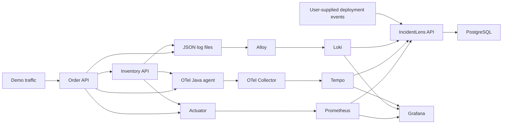

# IncidentLens

**An evidence-first incident investigation API built with Spring Boot.**

Start with a healthy order → inventory request, introduce a controlled dependency failure, then investigate its metrics, logs, traces, and a synthetic deployment event. Findings distinguish observations, hypotheses, and missing evidence.

This is a working learning MVP, not a production incident-management product or an autonomous root-cause engine. It uses only synthetic data and has no employer/client dependencies.

## Cost: start locally

The default deployment is **Docker Compose on your own computer**. It makes no AWS API calls and requires no paid cloud account. Software is open source; your existing hardware, electricity, internet, and any Docker Desktop licensing requirements still apply. This is not a promise of free public cloud hosting.

GitHub Actions runs Maven tests, builds the image, and verifies the Compose stack on standard GitHub-hosted Linux runners in this public repository. No external image registry is required for CI. Published image storage and optional cloud services have their own terms.

**AWS ECS/Fargate, ECR, CloudWatch, load balancers, databases, and networking can incur charges.** The separate AWS workflow is manual, requires explicit acknowledgement and preconfigured infrastructure, and does not run on normal pushes. No AWS resources have been created for this project.

## Stack

| Layer | Choice | Why it exists |
|---|---|---|
| APIs | Java 17, Spring Boot 3.5.16, Maven | Familiar supported JVM stack; one image runs in three modes |
| Metrics | Actuator + Micrometer → Prometheus | Request volume, 5xx fraction, latency histogram, JVM metrics |
| Traces | OpenTelemetry Java agent → Collector → Tempo | Follow an order request into inventory; one instrumentation approach |
| Logs | Spring structured JSON files → Alloy → Loki | Search ERROR events; correlate trace_id with Tempo |
| Visualization | Grafana | Provisioned metrics/log dashboard and Explore links |
| Reports | PostgreSQL | Persist investigations and deployment events |
| Packaging | Docker + Compose | Reproducible local stack, no Kubernetes dependency |
| CI/CD | GitHub Actions; optional ECR/ECS workflow | Test/build locally isolated CI, cloud delivery when explicitly configured |

H2 is used for API tests and standalone/demo process startup, not as the Compose report database. Backend Docker tags and the Java agent are pinned for reproducibility, not a claim that these are always the latest releases.

## Start

Prerequisites: Docker Engine with Compose v2 (or an appropriately licensed Docker Desktop installation), Python 3, and roughly 6 GB of memory available to Docker. Maven/Java on the host are optional when using Docker.

```sh
git clone https://github.com/sach3089/incidentlens.git
cd incidentlens
cp .env.example .env
# Set your own local passwords and demo key in .env.
docker compose up --build -d
bash scripts/smoke.sh
```

The smoke demonstration takes about 3 minutes after startup: 75 seconds healthy traffic, 75 seconds controlled failures, then export time. It resets the fault afterward. It writes `report.json` (ignored by Git) and asserts metrics, error logs, and error traces were returned.

| Address | Purpose |
|---|---|
| http://localhost:8081/api/v1/orders/demo | Demo order → inventory request |
| http://localhost:8082/actuator/health | Inventory health |
| http://localhost:8080 | IncidentLens API, HTTP Basic `analyst` + your INCIDENTLENS_PASSWORD |
| http://localhost:3000/d/incidentlens/services | Grafana, `admin` + your GRAFANA_PASSWORD |
| http://localhost:9090 | Prometheus expression browser |
| http://localhost:3100/ready | Loki readiness |
| http://localhost:3200/ready | Tempo readiness |

These addresses bind to **127.0.0.1**, not the public network. Health and Prometheus endpoints do not require authentication inside this local lab. Telemetry backend ports must not be exposed publicly as configured.

## Understand the architecture



Prometheus **pulls** metrics every 5 seconds. The agent **pushes** traces through the Collector. Alloy tails bounded JSON log files and pushes them to Loki. IncidentLens queries these systems; it does not replace them.

The same application artifact runs with APP_MODE=order, inventory, or incident. That keeps v1 small while isolating each process and service identity. A future extraction into separate build modules is possible without adding infrastructure now.

## APIs

See [the OpenAPI contract](docs/openapi.yaml) and [the walkthrough](docs/WALKTHROUGH.md).

```http
POST /api/v1/investigations
GET  /api/v1/investigations/{id}
GET  /api/v1/investigations/{id}/evidence
GET  /api/v1/investigations/{id}/timeline
POST /api/v1/deployment-events
```

Creation is synchronous in v1: HTTP 201 returns a persisted report. Two concurrent investigations are allowed; additional requests receive 429. Service names are allowlisted to avoid query injection; the window is 1–30 minutes and environment is `local`.

Source statuses: OK, EMPTY, UNAVAILABLE. Report status COMPLETE means all queries returned, even if some had no samples; PARTIAL means one or more backends failed. Neither means that all incident evidence was captured. Queries and coverage notes are included so results can be inspected.

The report includes bounded metric results, up to 30 ERROR log entries (selected fields), 10 example error traces, and 50 nearby deployment events. PostgreSQL stores those snapshots. Logging redaction is defense-in-depth for demo messages, not a universal PII detector.

## Tests and verification

```sh
./mvnw verify
# or: mvn verify
```

Tests cover authentication, invalid service input, persistence, backend HTTP adapters, window validation, and evidence/hypothesis separation. CI additionally builds the real image and exercises the complete Compose telemetry pipeline. See the latest Actions run for actual results; a local JVM test pass alone does not verify Docker configuration.

## Stop and clean up

```sh
docker compose down
# Optional destructive reset of this project's local reports and log volume:
docker compose down -v
```

PostgreSQL reports and application logs use named volumes. Prometheus, Tempo, Loki, and Grafana are intentionally disposable in this lab; restarting/recreating their containers can discard telemetry or settings. Report snapshots persist but linked trace data may no longer exist.

## Limits and next steps

- No automatic causal attribution, remediation, AI API calls, emails, or external notifications.
- Always-on tracing is a local learning choice, not a production sampling recommendation.
- Collectors/backends use plaintext on the private Compose network; Basic auth over localhost is a lab setup. Public deployment requires TLS, scoped identity, tenant isolation, hardened management endpoints, and backend authentication/network restrictions.
- Bounded synchronous querying is intended for local synthetic traffic. Production work needs durable background jobs, retention policy, pagination, service ownership, and per-user authorization.
- Next: query deep links per evidence item, a small investigation UI, real change-event ingestion, additional connectors, and only then optional evidence-citing AI summaries.

[Optional AWS path](docs/AWS.md) · [Learning walkthrough](docs/WALKTHROUGH.md)
